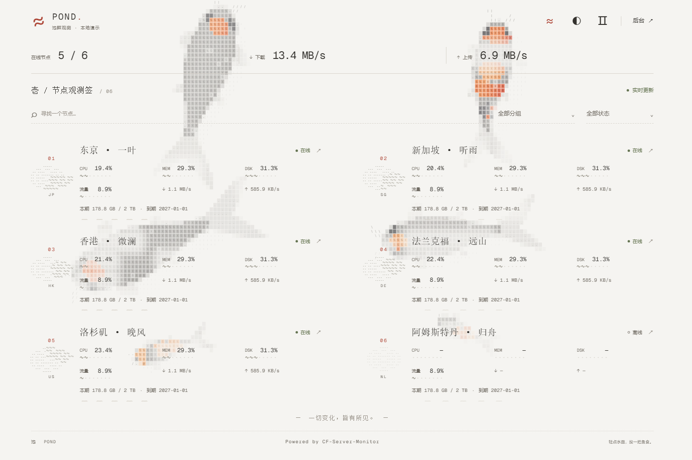
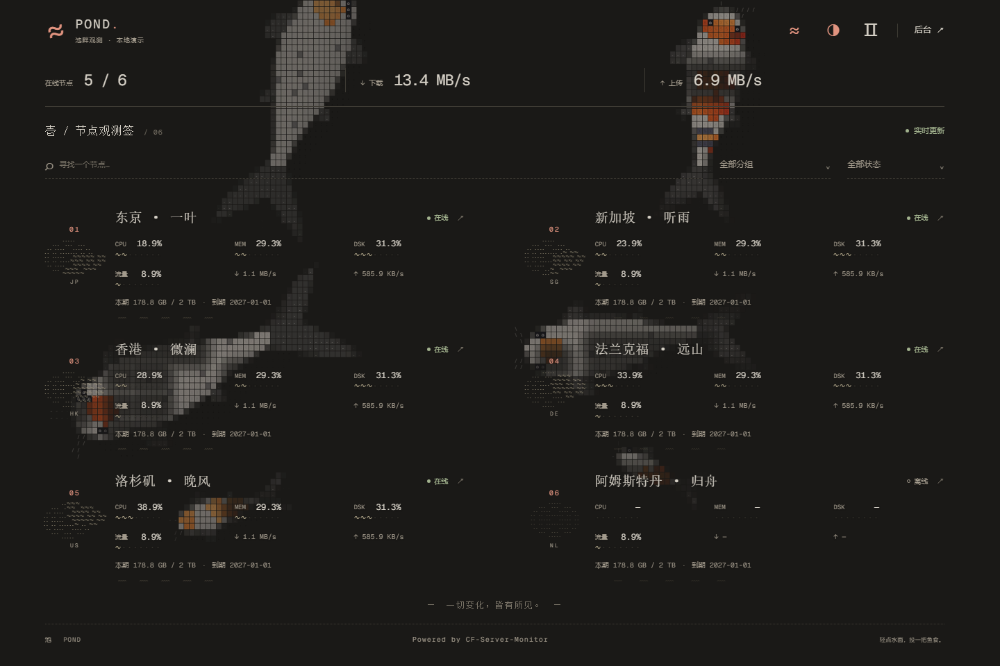
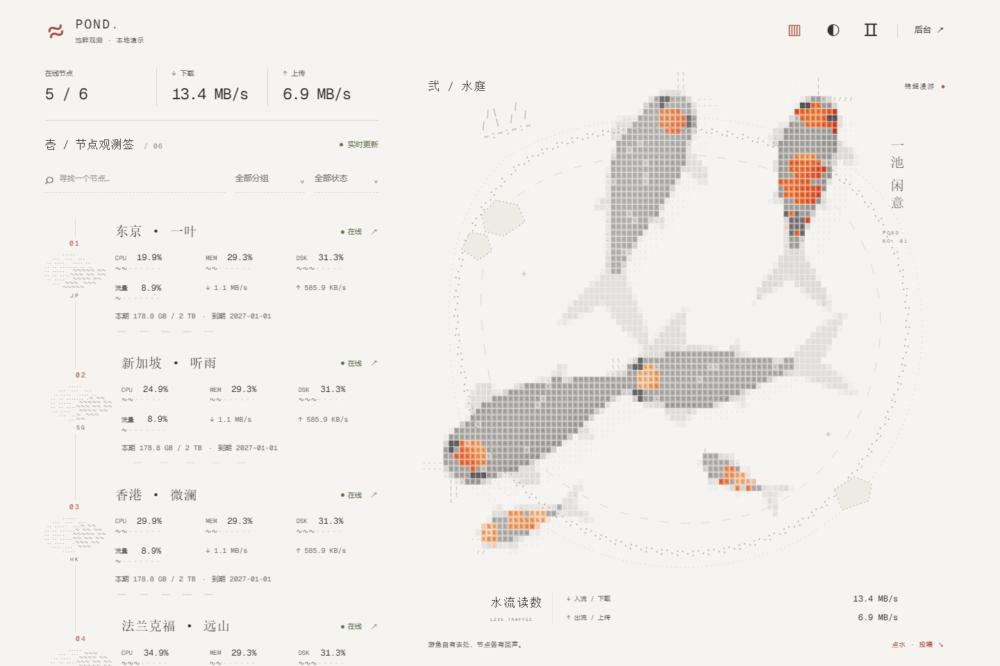
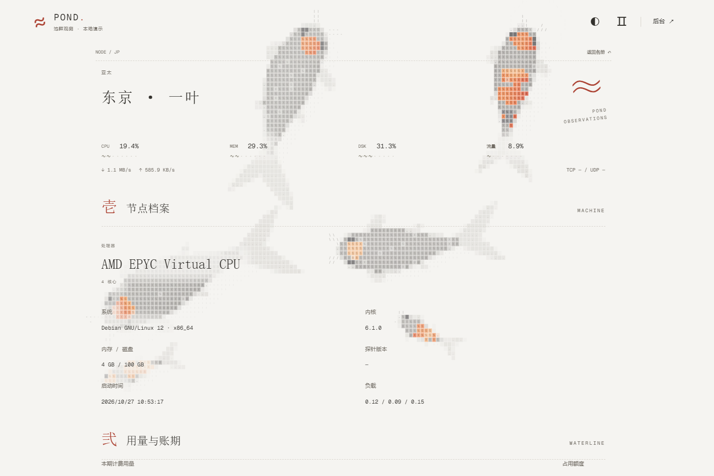
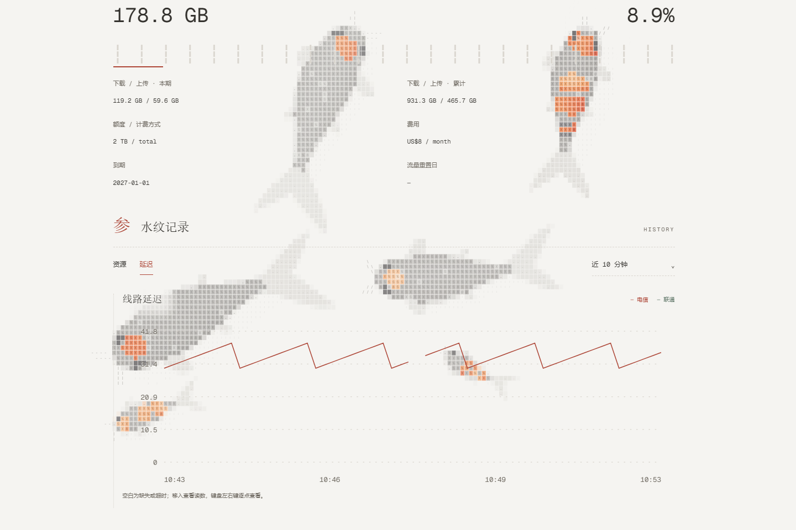
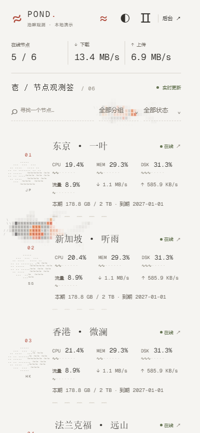

# 锦鲤池塘 · Pond for CF-Server-Monitor

字符锦鲤游过纸面，节点读数随水纹展开。适用于 [CF-Server-Monitor](https://github.com/huilang-me/CF-Server-Monitor) 的独立主题。

默认以全屏游鱼为背景，也可切换为名册与水庭并排的布局。支持纸白与暖黑、投喂与水波、暂停、搜索分组、节点详情、资源历史以及多线路延迟对照。首页标题默认留空，可在主题设置中填写。

<table>
<tr><th>暖黑游鱼</th><th>水庭模式</th></tr>
<tr><td></td><td></td></tr>
<tr><th>节点观测手札</th><th>合并线路延迟</th></tr>
<tr><td></td><td></td></tr>
</table>

预览中展示的是独立演示数据。

## 使用

主题产物为 `index.html` 与 `assets/`，用于 CF-Server-Monitor 的静态主题托管。它与 Monitor Hub 的 `theme.tar.gz` 安装包不通用。

同源部署直接连接当前站点；独立托管可配置 `API_BASE`，多个 Worker 地址用英文逗号分隔。每个 Worker 的 `CORS_ALLOWED_ORIGINS` 都需加入主题的 origin。管理及登录入口统一交给 Worker 的 `/admin#/admin`。

站点标题、语言、配色沿用后台设置。登录后点击齿轮，可将池塘布局、首页文案、投喂等选项保存到站点。访客的配色、显示方式与暂停选择保存在当前浏览器。

页头 `≈ / ▥` 切换布局，`◐ / ◑` 切换配色，`Ⅱ / ▷` 暂停或继续。轻点空白水面投喂，节点与图表区域不会触发投喂。

## GitHub Pages

仓库附带自动构建流程。设置仓库 Secrets：`API_BASE`，可选 `TITLE`、`BACKGROUND_IMAGE`、`CSP_API`、`CSP_STATIC`。启用 Actions 的 `contents: write` 权限，将 Settings → Pages 的托管分支选择为 `dist`。构建会追加提交并保留历史与源码提交说明。

## 开源与致谢

本主题采用 [MIT License](LICENSE)。视觉移植自 [ayingQAQ/monitor-ascii-pond](https://github.com/ayingQAQ/monitor-ascii-pond)，Geist Mono 字体采用 OFL，相关许可保留在 `licenses/` 并随静态产物交付。

字符锦鲤、游动、水波与投喂效果源自原项目 **[stqfdyr/ascii-pond](https://github.com/stqfdyr/ascii-pond)**，保留其 MIT 版权声明。
